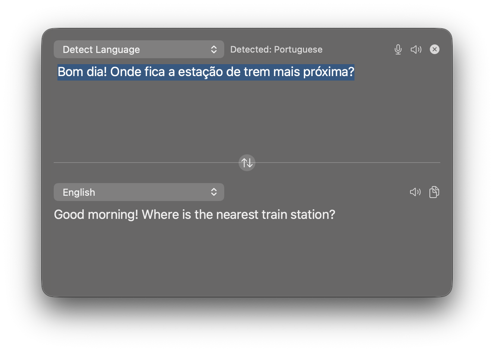

# TranslateMac

**A Spotlight-style translator for macOS that runs on your Mac.** Press `Cmd + \` in any app, type or paste, and
read the translation. It uses Apple's Translation framework, so the text you translate is not sent to a server.

[](https://github.com/paulo-amaral/TranslateMac/actions/workflows/ci.yml)
[](https://github.com/paulo-amaral/TranslateMac/releases/latest)
[](LICENSE)


<p align="center">
  
</p>

## Features

- **Floating panel -** Opens over any app or full-screen space with `Cmd + \` or from the menu bar icon. The app you
  were using stays in front.
- **On-device translation -** Apple's Natural Language framework detects the source language, and the Translation
  framework translates while you type. Unclear short text waits for more input or a manual language choice.
- **Translate a selection anywhere -** Select text in a browser or any app, right-click, then
  Services > Translate with TranslateMac.
- **Dictation -** Speak instead of typing. Choose the spoken language first; speech recognition runs on the Mac only.
- **Listen and copy -** Hear the original or the translation, copy the result, swap the languages.
- **Spelling suggestion -** "Did you mean" for the whole sentence from the on-device Apple Intelligence model when
  it is ready (macOS 26 or later), otherwise from the system spell checker.
- **Small and native -** Swift, SwiftUI and AppKit. No third-party packages, no Electron, no web view.

## Privacy

- No network code. Translation and dictation run on the Mac.
- The text you translate is never saved or logged. The app stores the last two language codes, nothing else.
- Microphone and Speech Recognition access are requested only when you start dictation.

Details are in [SECURITY.md](SECURITY.md).

## Install

Requires macOS 15 or later.

1. Download `TranslateMac.zip` from the [latest release](https://github.com/paulo-amaral/TranslateMac/releases/latest).
2. Unzip it and move `TranslateMac.app` to the Applications folder.
3. Open it. The app is not notarized by Apple, so the first time macOS asks for confirmation in
   System Settings > Privacy & Security > Open Anyway.

The first time a language pair is used, macOS may ask to download the language. Accept it in the system sheet.

To check the download:

```sh
shasum -a 256 -c TranslateMac.zip.sha256
gh attestation verify TranslateMac.zip --repo paulo-amaral/TranslateMac \
  --signer-workflow paulo-amaral/TranslateMac/.github/workflows/release.yml
```

## Shortcuts

| Shortcut | Action |
| --- | --- |
| `Cmd + \` | Show the panel, focus it, or hide it (works in any app) |
| `Esc` | Hide the panel |
| `Tab` | Give the keyboard back to the app in front |
| `Cmd + L` | Listen to the original text |
| `Cmd + S` | Swap languages |
| `Cmd + Return` | Apply the spelling suggestion |

Click the menu bar icon to show or hide the panel. Right-click it to quit.

The Services entry can be turned on or off, and given its own keyboard shortcut, in
System Settings > Keyboard > Keyboard Shortcuts > Services.

## Build from source

Requires Xcode 26 or later (built with Xcode 26.5, Swift 6.3).

```sh
make test   # unit tests
make run    # build .build/TranslateMac.app and open it
```

`make app` wraps the SwiftPM executable in an app bundle. The bundle is needed for the Services entry and for the
microphone permission.

## Project layout

- `Sources/TranslateCore`: state and rules, testable without a window.
- `Sources/TranslateUI`: SwiftUI views, translation session adapter, speech and dictation.
- `Sources/TranslateMac`: app entry point, floating panel, global shortcut, menu bar item, Services handler.
- `App/` and `scripts/make-app.sh`: app bundle.
- `docs/`: scope and architecture decisions.

## Roadmap

Planned, not built yet: conversation mode, translation of text in images, and a translation engine based on
Apple Intelligence.

## Contributing

Issues and pull requests are welcome. Read [CONTRIBUTING.md](CONTRIBUTING.md) first.

## License

[MIT](LICENSE)
